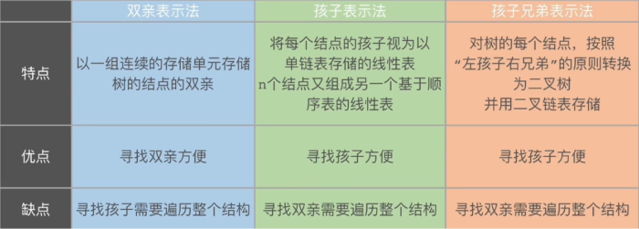
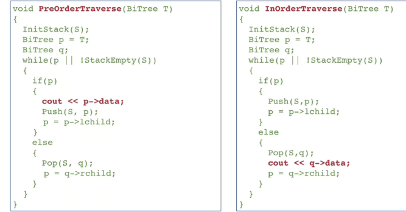
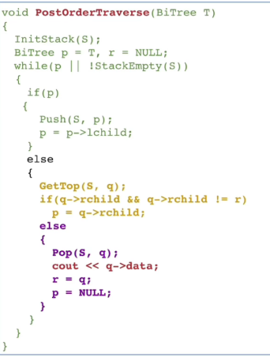

# 树与二叉树

## 树形相关性质与结论

- **节点总数 = 分支数 + 1**
> 这是由树的定义所导出的重要性质，除了根节点以外，每个节点都有唯一前继
- $n = n_0 + n_1 + n_2 + ... + n_k $
利用上面的性质进一步导出
$n = 0 * n_0 + 1 * n_1 + 2 * n_2 + ... + k * n_k + 1$
> 特别地，对非空二叉树而言，联立上面两式有$n_0 = n_2 + 1$
- 度为m的树第i层（从1开始）最多$m^{i-1}$个结点
- 高度为h的完美m叉树一共有$\frac{m^h-1}{m-1}$个结点
> 特别地，对于高度为h的完美二叉树而言，一共有$2^h - 1$个节点
- 完全二叉树只有最后两层可能出现叶子结点
- 具有n个节点的完全二叉树高度为$\lceil  \log_2(n+1)\rceil$ / $\lfloor \log_2n\rfloor + 1$
> 简单证明：利用完全二叉树和完美二叉树的性质得到 $2^{h-1} - 1 < n \le 2^h - 1$
- 对完全二叉树按照层序进行编号，i = 1, 2..., n
    1. i为偶数时，父节点为 **i/2**，i是父节点的 **左孩子**；i为奇数时，父节点为 **(i - 1)/2**，i是父节点的 **右孩子**
    2. i的左孩子为2i或者不存在，i的右孩子为2i+1或者不存在
    3. $i \le \lfloor n/2 \rfloor$时，i为分支节点；否则，i为叶子结点
    4. 若n为奇数，则每个分支节点都有左右孩子；若n为偶数，则i=n/2（最后一个分支结点）只有左孩子
    > 推论：完全二叉树中度为1的结点只可能有一个或者零个

## 树的存储

- 二叉树的两种存储方式
    - 数组顺序存储
    - 链表链式存储
    > n个结点的二叉链表有n + 1个空链域
- 树的三种存储方式
    - 双亲表示法
    - 孩子兄弟表示法
    - 孩子表示法
    

## 树的遍历

- 先序遍历
- 中序遍历
    - 中序线索树中，若某结点有右孩子，则它的后继结点是它 **右子树最左下**的结点
    - 中序线索树中，若某结点有左孩子，则它的前驱结点是它 **左子树最右下**的结点
    
- 后序遍历
    
- 层序遍历
- 唯一确定一棵二叉树
    - 中序 + 先序
    - 中序 + 后序
    - 中序 + 层序
- 火车进站问题，如果进栈的是先序遍历，那么出栈的则为后序遍历

## 二叉树/树/森林转换

- 左孩子，右兄弟
- 树 -> 二叉树
    - 加线：把同一个父结点的相邻兄弟结点连接起来
    - 抹线：每个父结点只保留与第一个孩子的连线，删除与其它孩子的连线
    - 调整图形
- 森林 -> 二叉树
先分别转换，再把森林中各棵树的根结点看作兄弟，用右指针依次连接
- 二叉树 -> 树/森林
如果二叉树根结点没有右孩子，就可以还原成一颗普通树，否则转成森林；后面按左孩子右兄弟逆向转换
> 看二叉树根结点的右链，就能判断它所表示的森林有多少棵树
- 森林/树的遍历
    - 先根遍历：转换二叉树的先序遍历
    - 后根遍历：转换二叉树的中序遍历

## huffman树

- huffman树只有度为0和2的结点（满二叉树），即$n = n_0 + n_2$
- 要求的字符结点一定为叶子结点
- 由非空二叉树的性质$n_0 = n_2 + 1$得到huffman树总结点个数$n = 2n_0 - 1 = 2n_2 + 1$，从而huffman树创建过程中新建了$n_0-1$个结点
- 同一组权值构造出的huffman树可能不唯一
- huffman树是带权路径长度最小的树
- 可以拓展成m叉huffman树，注意补充虚段，计算$k = (n_0-1) mod (m -1)$，如果$k \ne 0$，需要补充$m - 1 - k$个权为0的结点